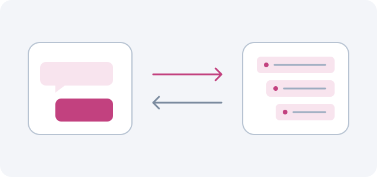

# dsh-rider-mcp

Connect DeepSeek Harness (DSH) to the MCP server built into
[JetBrains Rider](https://www.jetbrains.com/rider/): every DSH conversation gets its own Rider
connection, a project picker, and a live connection badge in the composer.



> Unofficial community plugin. Not affiliated with, endorsed by, or supported by JetBrains or
> DeepSeek. "JetBrains" and "Rider" are trademarks of JetBrains s.r.o.

[](https://github.com/ChongYuGit/dsh-rider-mcp/actions/workflows/ci.yml)
[](https://www.npmjs.com/package/dsh-rider-mcp)
[](LICENSE)

## Features

- **One connection per conversation.** Each DSH session mounts its own MCP client under the server
  name `rider`, so `mcp__rider__*` can target project A in one session and project B in another.
- **Project picker.** By default no project is pinned: each tool call names the open Rider project
  through its `rootFolder` argument (usually the session workspace path). You can pin one project
  per session instead.
- **Connection badge.** The badge above the composer shows the live state (connected, connecting,
  reconnecting, failed, disconnected), the tool count, and the project this conversation last worked
  on. Click it to choose a project, disconnect, or reconnect.
- **Per-session persistence.** Choices are stored per session and survive a restart without
  rewriting `cordis.patch.yml` or reloading the plugin.
- **Long calls allowed.** Tool calls such as builds get a five-minute timeout.
- **Local only.** Speaks streamable HTTP to `127.0.0.1`; no telemetry and no other network access.

## Requirements

- **Rider 2025.3 or later** with the bundled **MCP Server** plugin enabled. The default endpoint is
  `http://127.0.0.1:64482/stream`. Rider must be running; while it is closed the connection is
  unavailable.
- **DSH 0.2.2-rc.x** (tested with 0.2.2-rc.5). `engines.dsh` requires `>=0.2.2-rc.1`.
- **Node.js 22+** only for development. The published bundle has no runtime dependencies and no
  build step.

DSH's MCP client speaks streamable HTTP only, so Rider's SSE endpoint (`/sse`) is not used.

## Install

### From npm

Install the bundle with DSH's plugin manager, passing the package name:

```text
plugin_manager → install_bundle → target: dsh-rider-mcp
```

In DSH Desktop, **Plugins → Add plugin** works too when your build accepts an npm spec. Open a new
session afterwards so the tools are mounted.

### From a local clone

```bash
git clone https://github.com/ChongYuGit/dsh-rider-mcp.git
```

Then **Plugins → Add plugin** and choose the cloned directory, or pass its absolute path to
`plugin_manager` → `install_bundle`. A local directory is linked, not copied, so edits are live
after a DSH restart.

## Usage

1. Start Rider, open the project(s) you want, and enable its MCP server (it ships as the **MCP
   Server** plugin; check Rider's settings if the endpoint is not on port 64482).
2. Open a DSH session. Rider tools appear as `mcp__rider__*`.
3. Call a tool with `rootFolder` set to the project path, or click the badge above the composer and
   pin a project for this session:

   - **Per call** — no project header; each call selects through `rootFolder`.
   - **An open project** — discovered from Rider, pinned for this session with the
     `IJ_MCP_SERVER_PROJECT_PATH` header.
   - **A typed path** — the same pin for a project Rider does not report.

4. **Disconnect** revokes only this session's registration and removes its tools; **Connect**
   restores them. Other sessions keep their own project and state.

The dot on the badge stays amber until a project is known and turns green afterwards. Hovering
shows the last tool call's `rootFolder`.

## Configuration

The bundle row's `config` sets defaults:

```yaml
url: http://127.0.0.1:64482/stream
projectPath: ''        # empty: choose per tool call; else pin this project
toolCallTimeoutMs: 300000
```

- `url` — Rider's streamable HTTP endpoint. Change it if you moved Rider's MCP port.
- `projectPath` — default pinned project. Empty sends no `IJ_MCP_SERVER_PROJECT_PATH` header.
- `toolCallTimeoutMs` — per-call timeout; the default is five minutes.

Each session's own choice is stored in `rider-mcp.sessions.json` beside the active DSH profile and
overrides these defaults for that session.

## How it works

| File | Role |
| --- | --- |
| `index.js` | Host entry: mounts one `mcp-client` Fiber per Agent under the name `rider`, serves the badge routes under `/rider-mcp`, and remembers each session's last `rootFolder`. |
| `session-runtime.js` | Shared per-Agent runtime: creates, restarts, pauses, and persists one MCP client Fiber per session. |
| `client.js` | Web entry: registers the composer badge and panel, polls `/rider-mcp/status` every two seconds, and posts project/connection changes with `?session=<SessionId>`. |
| `cordis.patch.yml` | Inserts the plugin row and its default config. |
| `locale/*.json` | Localized title, description, and detail document for Plugin Manager. |

The HTTP routes are same-origin guarded and exist only inside DSH's own web server. Rider is
contacted over streamable HTTP; the plugin reads Rider's open projects through the
`get_all_open_file_paths` tool of a throwaway session.

## Limitations

- A session can use one Rider connection at a time; the server name `rider` is fixed, so another
  plugin registering the same name conflicts.
- Project discovery depends on Rider's `get_all_open_file_paths`; if it reports nothing, type the
  path manually.
- No TLS or authentication: the endpoint is assumed to be `127.0.0.1`.
- The session state file contains local project paths; it never leaves your machine.
- Disabling or removing the bundle removes the tools.

## Troubleshooting

| Symptom | Cause and fix |
| --- | --- |
| Badge shows **failed** or **unreachable** | Rider is closed, its MCP server is disabled, or the port differs. Start Rider, enable the server, and correct `url`. |
| Badge stays amber | No project is known yet. Pin one from the panel, or pass `rootFolder` in the call. |
| No `mcp__rider__*` tools | Open a new session; check that the bundle row is enabled in **Plugins**. |
| `cross-origin-denied` | The route was opened from another origin. Use the DSH interface; the guard is intentional. |
| A build times out | Raise `toolCallTimeoutMs`. |
| Tools vanish after **Disconnect** | Expected: only this session's registration was revoked. Click **Connect** or reopen the session. |

## Development

```bash
git clone https://github.com/ChongYuGit/dsh-rider-mcp.git
cd dsh-rider-mcp

node --check index.js
node --check client.js
node --check session-runtime.js
node scripts/check.mjs
npm pack --dry-run
```

`node scripts/check.mjs` validates the manifest, the client module id (it must equal the package
name), the loader patch, exported assets, locale metadata, and the packaged file list. There is no
build step and no dependency to install.

When changing behavior, keep these invariants: one MCP client Fiber per session, no process-global
Rider registration, routes scoped by `?session=`, and matching keys in `locale/en.json` and
`locale/zh.json`.

See [CONTRIBUTING.md](CONTRIBUTING.md) for the pull-request checklist and [CHANGELOG.md](CHANGELOG.md)
for releases.

## Security

The plugin only talks to the configured Rider URL and does not collect or send telemetry. Badge
routes reject cross-origin requests, and session state stays in the local DSH profile. If you expose
DSH beyond localhost, review that threat model before enabling this bundle.

## License

[MIT](LICENSE) © 2026 ChongYuGit.
