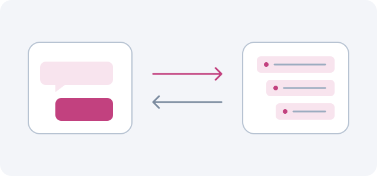

# dsh-rider-mcp

把 DeepSeek Harness（DSH）连接到 JetBrains Rider 内置的 MCP 服务：每个 DSH 会话拥有独立的 Rider 连接、项目选择面板，以及输入框上方的连接状态徽标。



> 非官方社区插件，与 JetBrains、DeepSeek 均无隶属或背书关系。JetBrains、Rider 是 JetBrains s.r.o. 的商标。

## 功能

- **每个会话独立连接。** 每个 DSH 会话各自挂载一个名为 `rider` 的 MCP 客户端，因此会话 A 的 `mcp__rider__*` 可以指向项目 A，会话 B 指向项目 B。
- **项目选择。** 默认不绑定项目：每次工具调用用 `rootFolder` 参数指定 Rider 中已打开的项目（通常是会话工作区路径）。也可以为当前会话固定一个项目。
- **状态徽标。** 输入框上方的徽标实时显示连接状态（已连接、连接中、重连中、连接失败、已断开）、工具数量，以及本会话最近一次调用使用的项目。点击可切换项目、断开或重连。
- **按会话保存。** 选择只影响当前会话，重启后恢复，不需要改写 `cordis.patch.yml`，也不需要重载插件。
- **长调用。** 构建等耗时工具调用放宽到 5 分钟超时。
- **仅本机。** 通过 streamable HTTP 访问 `127.0.0.1`，无遥测、无其他网络访问。

## 前置条件

- **Rider 2025.3 或更高版本**，并启用随 IDE 提供的 **MCP Server** 插件；默认端点为 `http://127.0.0.1:64482/stream`。Rider 必须保持运行，关闭期间连接不可用。
- **DSH 0.2.2-rc.x**（在 0.2.2-rc.5 上验证）。`engines.dsh` 要求 `>=0.2.2-rc.1`。
- **Node.js 22+** 仅用于开发。发布包没有运行时依赖，也没有构建步骤。

DSH 的 MCP 客户端只支持 streamable HTTP，因此不使用 Rider 的 SSE 端点（`/sse`）。

## 安装

### 从 npm 安装

用 DSH 的插件管理器按包名安装：

```text
plugin_manager → install_bundle → target: dsh-rider-mcp
```

DSH Desktop 里若 **插件 → 添加插件** 支持 npm 包名，也可以直接填 `dsh-rider-mcp`。安装后新开一个会话，工具才会挂载。

### 从本地克隆安装

```bash
git clone https://github.com/ChongYuGit/dsh-rider-mcp.git
```

然后在 **插件 → 添加插件** 里选择克隆下来的目录，或把绝对路径传给 `plugin_manager` → `install_bundle`。本地目录是链接安装，修改源码后重启 DSH 即生效。

## 使用

1. 启动 Rider，打开需要的项目，并启用 MCP 服务（随 IDE 提供的 **MCP Server** 插件；如果端口被改过，请在 Rider 设置里确认）。
2. 打开一个 DSH 会话，Rider 工具以 `mcp__rider__*` 出现。
3. 调用工具时把 `rootFolder` 设为项目路径；或点击输入框上方的徽标，为当前会话固定一个项目：

   - **按调用指定** —— 不发项目头，每次调用用 `rootFolder` 决定。
   - **Rider 中打开的项目** —— 从 Rider 读取后固定到本会话（发送 `IJ_MCP_SERVER_PROJECT_PATH` 头）。
   - **手动输入路径** —— 对 Rider 未上报的项目做同样的固定。

4. **断开连接**只撤销当前会话的注册并移除其工具；**连接**恢复。其他会话不受影响。

徽标上的圆点在项目确定前是黄色，确定后转绿。悬停可查看最近一次工具调用的 `rootFolder`。

## 配置

插件行的 `config` 提供默认值：

```yaml
url: http://127.0.0.1:64482/stream
projectPath: ''        # 留空：按调用选择；否则固定该项目
toolCallTimeoutMs: 300000
```

- `url` —— Rider 的 streamable HTTP 端点；改动过 Rider MCP 端口时同步修改。
- `projectPath` —— 默认固定项目。留空则不发送 `IJ_MCP_SERVER_PROJECT_PATH` 头。
- `toolCallTimeoutMs` —— 单次调用超时，默认 5 分钟。

每个会话自己的选择保存在 DSH 配置目录旁的 `rider-mcp.sessions.json` 中，并覆盖默认值。

## 工作原理

| 文件 | 作用 |
| --- | --- |
| `index.js` | Host 入口：为每个 Agent 挂载一个名为 `rider` 的 `mcp-client` Fiber，提供 `/rider-mcp` 下的徽标路由，并记录每个会话最近一次的 `rootFolder`。 |
| `session-runtime.js` | 共享的按 Agent 运行时：创建、重启、暂停并持久化每个会话的 MCP 客户端 Fiber。 |
| `client.js` | Web 入口：注册输入框徽标与面板，每 2 秒轮询 `/rider-mcp/status`，并用 `?session=<SessionId>` 提交项目/连接变更。 |
| `cordis.patch.yml` | 插入插件行及其默认配置。 |
| `locale/*.json` | 插件管理器中显示的本地化标题、描述与详情文档。 |

HTTP 路由只存在于 DSH 自己的 Web 服务中，并做了同源校验。插件通过 streamable HTTP 访问 Rider，并用一次性的 MCP 会话调用 `get_all_open_file_paths` 读取 Rider 中打开的项目。

## 限制

- 一个会话同时只使用一个 Rider 连接；服务名固定为 `rider`，其他插件注册同名服务会冲突。
- 项目发现依赖 Rider 的 `get_all_open_file_paths`；它没有返回结果时请手动输入路径。
- 没有 TLS 和鉴权，端点按 `127.0.0.1` 本机服务对待。
- 会话状态文件包含本机项目路径，不会离开本机。
- 禁用或移除插件会移除这些工具。

## 故障排查

| 现象 | 原因与处理 |
| --- | --- |
| 徽标显示**连接失败**或**无法检测** | Rider 未运行、MCP 服务未启用，或端口不同。启动 Rider、启用服务并修正 `url`。 |
| 徽标一直是黄色 | 尚未确定项目。在面板中固定项目，或在调用中传入 `rootFolder`。 |
| 没有 `mcp__rider__*` 工具 | 新开会话；检查 **插件** 中该行是否启用。 |
| `cross-origin-denied` | 从其他来源打开了路由。请使用 DSH 界面，同源校验是刻意保留的。 |
| 构建调用超时 | 调大 `toolCallTimeoutMs`。 |
| 点击**断开连接**后工具消失 | 正常：只撤销了当前会话的注册。点**连接**或重开会话即可恢复。 |

## 开发

```bash
git clone https://github.com/ChongYuGit/dsh-rider-mcp.git
cd dsh-rider-mcp

node --check index.js
node --check client.js
node --check session-runtime.js
node scripts/check.mjs
npm pack --dry-run
```

`node scripts/check.mjs` 会校验清单、客户端模块 id（必须等于包名）、加载器补丁、导出资源、本地化元数据与打包文件列表。没有构建步骤，也不需要安装依赖。

修改行为时请保持这些不变量：每个会话一个 MCP 客户端 Fiber、没有进程级全局 Rider 注册、路由按 `?session=` 隔离、`locale/en.json` 与 `locale/zh.json` 的键保持一致。

提交前请阅读 [CONTRIBUTING.md](CONTRIBUTING.md)，版本变更见 [CHANGELOG.md](CHANGELOG.md)。

## 安全

插件只访问配置的 Rider 地址，不收集也不发送遥测。徽标路由拒绝跨源请求，会话状态只保存在本机 DSH 配置目录。如果把 DSH 暴露到本机之外，请先评估这一威胁模型再启用。

## 许可证

[MIT](LICENSE) © 2026 ChongYuGit。
